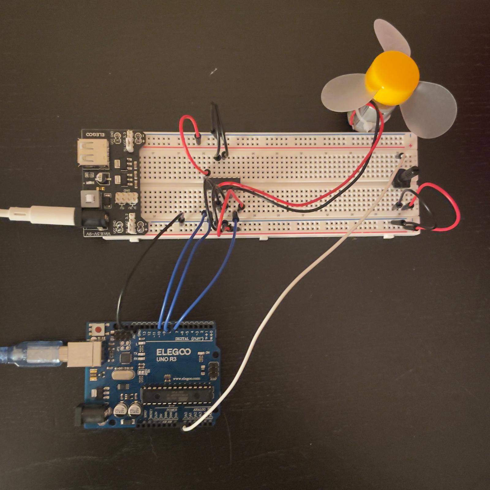
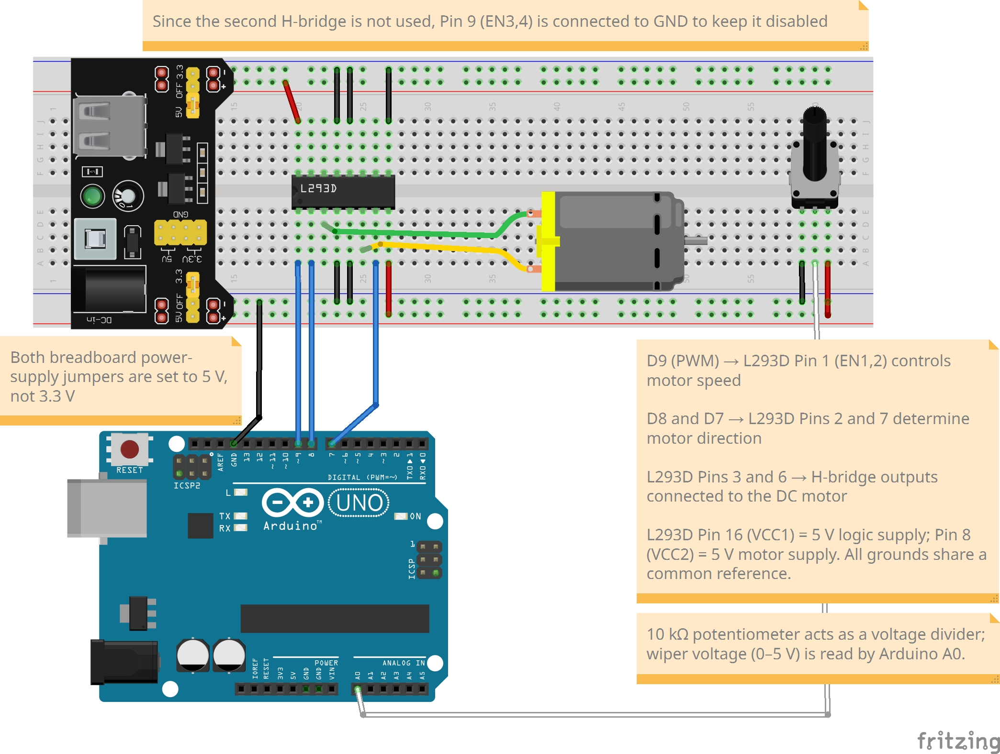

# Arduino PWM Motor Controller

A 10 kΩ potentiometer controls the drive duty cycle of a DC motor through an L293D motor driver. Turning the dial changes the fan speed. The Arduino reads the potentiometer on A0 and sends PWM from D9 to the driver's Enable input.

This is Project 3 in my Arduino portfolio, building toward an automated aquarium controller. It introduces PWM, motor drivers, and the difference between commanding power and regulating actual speed.



## Features

- Converts a potentiometer reading from 0–1023 to a PWM command from 0–255.
- Keeps one rotation direction using D8 LOW and D7 HIGH.
- Sets commands below PWM 40 to zero to reduce low-duty humming observed in this setup.
- Prints ADC, PWM, duty cycle, and an idealized voltage estimate at 9600 baud.
- Updates the command approximately every two seconds.

## Components

| Component | Quantity |
|---|---:|
| ELEGOO UNO R3 / Arduino UNO-compatible board | 1 |
| L293D motor driver | 1 |
| Small DC motor with fan blade | 1 |
| 10 kΩ potentiometer | 1 |
| MB-V2 breadboard power supply | 1 |
| Breadboard | 1 |
| Jumper wires | As needed |
| USB cable and suitable external module power source | As needed |

The motor uses the external supply through the L293D. Do not power it from an Arduino I/O pin. Choose a motor and supply compatible with the driver, including startup and stall current. The L293D is rated for up to 600 mA continuous output current per channel, subject to its thermal limits. See the [TI datasheet](https://www.ti.com/lit/ds/symlink/l293.pdf).

## Wiring guide

Disconnect power before assembling or changing connections. Identify L293D pin 1 using its notch or dot and the datasheet's top-view pin diagram.

| Connection | Destination |
|---|---|
| Arduino D9 (PWM) | L293D pin 1 — Enable 1,2 |
| Arduino D8 | L293D pin 2 — IN1 |
| Arduino D7 | L293D pin 7 — IN2 |
| Motor leads | L293D pins 3 and 6 — outputs |
| Regulated 5 V logic supply | L293D pin 16 — VCC1 |
| Regulated 5 V motor supply in this build | L293D pin 8 — VCC2 |
| Common GND | L293D pins 4, 5, 12, and 13 |
| Common GND | Arduino GND and power-supply GND |
| Common GND | Unused Enable pin 9 and unused input pins 10 and 15 |
| Unused outputs 11 and 14 | Leave unconnected |
| Potentiometer outer terminals | Regulated 5 V and common GND |
| Potentiometer center terminal (wiper) | Arduino A0 |

Set both module output jumpers to **5 V**. The L293D logic supply requires at least 4.5 V, so a 3.3 V logic supply is outside its specified range. Follow the module's input-voltage and polarity markings. This build powers the Arduino through USB and shares ground with the motor supply; no external 5 V connection to the Arduino 5 V pin is required.

Check for split breadboard rails and bridge them where required. Follow the datasheet's supply-decoupling guidance when reproducing the circuit.

### Breadboard diagram



### Schematic


**Diagram correction:** The supplied schematic leaves ground pin 13 and unused input pin 15 unconnected. Connect both to common GND as listed above. Use the wiring table as the reference for these connections.

## How it works

The potentiometer acts as a voltage divider. `analogRead(A0)` returns a value from 0 to 1023, and `map()` rescales it to the 0–255 range used by `analogWrite()`.

```cpp
int pwmValue = map(potValue, 0, 1023, 0, 255);
```

On an UNO R3, the default PWM frequency on D9 is approximately 490 Hz. PWM changes the fraction of time that the driver is enabled. The motor winding inductance and mechanical inertia smooth its response. See the [Arduino analogWrite reference](https://github.com/arduino/reference-en/blob/master/Language/Functions/Analog%20IO/analogWrite.adoc).

The sketch fixes IN1 LOW and IN2 HIGH. Actual rotation direction depends on how the motor leads are connected.

The serial voltage value is calculated as `PWM / 255.0 × 5.0`. It is an **idealized PWM voltage estimate**, not measured motor-terminal voltage. It excludes the L293D voltage drops and current recirculation during disabled intervals. Likewise, the PWM command is not a measured RPM value.

## Setup and operation

1. Assemble and check the wiring with power disconnected.
2. Verify the 5 V output settings and common ground connections.
3. Create an Arduino sketch named `PWM_Motor_Controller` and paste in the code below.
4. Select your board and serial port, then upload using USB.
5. Set the potentiometer to the minimum position before enabling motor power.
6. Open the Serial Monitor at **9600 baud**.
7. Turn the dial gradually and allow about two seconds for each command update.

No additional libraries are required. Secure the motor and keep fingers and loose objects away from the rotating blade. Disconnect power before checking a stalled motor or changing its wiring.

## Code

This listing matches the R1 report: it keeps the saved sketch's direction and two-second delay, while consolidating the serial output and accurately labeling the voltage calculation.

```cpp
const int potPin = A0;
const int enablePin = 9;  // L293D pin 1
const int input1Pin = 8;  // L293D pin 2
const int input2Pin = 7;  // L293D pin 7

void setup() {
  pinMode(enablePin, OUTPUT);
  pinMode(input1Pin, OUTPUT);
  pinMode(input2Pin, OUTPUT);
  digitalWrite(input1Pin, LOW);
  digitalWrite(input2Pin, HIGH);
  Serial.begin(9600);
}

void loop() {
  int potValue = analogRead(potPin);
  int pwmValue = map(potValue, 0, 1023, 0, 255);

  // Observed low-duty threshold for this setup.
  if (pwmValue < 40) pwmValue = 0;

  float dutyCycle = (pwmValue / 255.0) * 100.0;
  // Calculated reference only; excludes driver losses.
  float idealVoltage = (pwmValue / 255.0) * 5.0;

  analogWrite(enablePin, pwmValue);
  Serial.print("ADC: "); Serial.print(potValue);
  Serial.print("  PWM: "); Serial.print(pwmValue);
  Serial.print("  Duty: "); Serial.print(dutyCycle, 1);
  Serial.print("%  Ideal PWM estimate: ");
  Serial.print(idealVoltage, 2); Serial.println(" V");

  // Blocks potentiometer updates for about two seconds.
  delay(2000);
}
```

## Limitations and improvements

- **Open-loop control:** Speed is not measured. Increasing load can reduce RPM even when PWM stays constant.
- **Observed threshold:** PWM 40 was the startup threshold reported for this motor, supply, and load. Different conditions can require a different setting. The guard does not detect or prevent all stalls.
- **Response time:** `delay(2000)` blocks new potentiometer readings. A `millis()` timer would allow faster input handling while limiting serial output frequency.
- **Driver losses:** Motor voltage is lower than an ideal lossless-driver calculation suggests.

Future improvements include measuring speed with an encoder or tachometer, adding current monitoring, and using feedback control to adjust PWM under changing load.

## Troubleshooting

| Symptom | Check |
|---|---|
| Motor does not run | 5 V settings, supply capacity, driver orientation, Enable wiring, and common GND |
| Motor hums but does not rotate | Disconnect power; check mechanical load and the observed startup threshold |
| Motor turns in the opposite direction | Motor lead polarity; disconnect power before swapping leads |
| Dial changes seem delayed | The sketch samples approximately every two seconds |
| ADC reading does not change | Potentiometer outer connections and wiper-to-A0 wiring |
| Driver becomes unusually hot | Motor load/current and wiring; disconnect power before investigating |

## Project media and report

- [Build photograph](Project3_PWM_Motor_Controller_Image.jpeg)
- [Breadboard diagram](Project3_PWM_Motor_Controller_Breadboard.jpg)
- [Schematic](Project3_PWM_Motor_Controller_Schema.jpg)
- [Demonstration video](Project3_PWM_Motor_Controller_Video.mp4)
- [Project report — R1 (Word)](Project3_PWM_Motor_Controller_R1.docx)

## Hardware verification checklist

| Check | Expected behavior |
|---|---|
| Minimum dial position | PWM command 0; motor coasts to a stop |
| Raw mapped PWM below 40 | Output command becomes 0 |
| Increasing dial position | Commanded duty cycle increases; fan speed generally increases |
| Maximum dial position | PWM command 255; driver continuously enabled |
| Serial output | ADC, PWM, duty cycle, and idealized voltage estimate appear |
| Direction | Remains fixed for the chosen motor lead polarity |

## What I learned

This project showed why motors need a driver, how PWM changes delivered power, and why a command does not guarantee a particular speed. Finding the low-duty startup threshold connected the software to the motor's friction, load, and supply conditions.

## GitHub upload guidance

Use **`arduino-pwm-motor-controller`** as the repository name to match the naming of the other Arduino projects. Upload this README and the five referenced project files together at the repository root, keeping their filenames unchanged. Save the code as `PWM_Motor_Controller/PWM_Motor_Controller.ino` if you also want a downloadable Arduino sketch.
